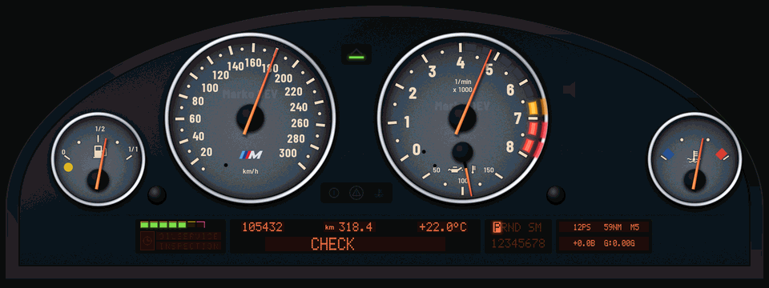
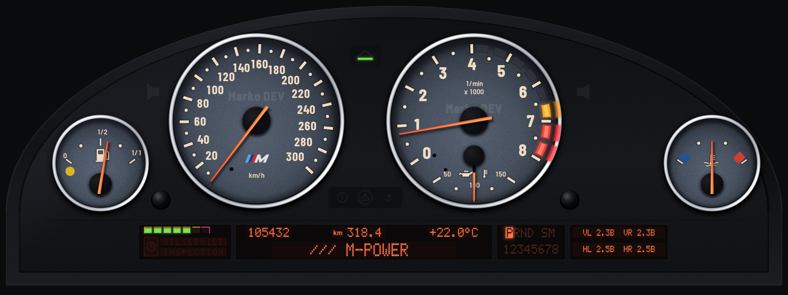
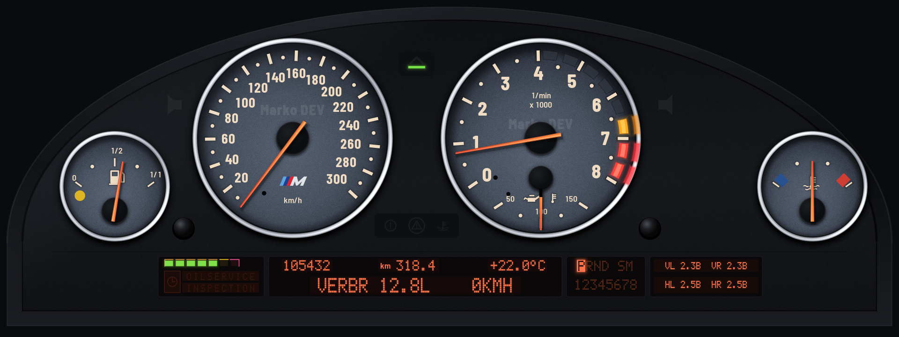
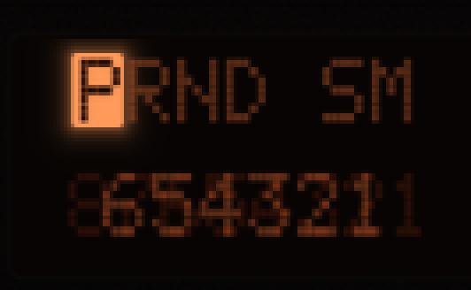
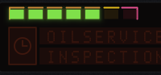

# BMW E39 M5 Digital Cluster for iDrive 7 / 8 (MGU)

<p align="center">
  <a href="https://buymeacoffee.com/makiidrajf0" target="_blank">
    
  </a>
  &nbsp;
  
  &nbsp;
  
</p>

<h3 align="center">
  Created with passion by <strong>Marko DEV</strong> &bull; Entwickelt von <strong>Marko DEV</strong>
</h3>

<p align="center">
  <b>Sprachauswahl / Language:</b><br>
  <a href="#-deutsch">🇩🇪 <b>Deutsch</b> (Danksagung, Aufbau, Anleitung & Rechtliches)</a> &nbsp;|&nbsp; 
  <a href="#-english">🇬🇧 <b>English</b> (Acknowledgments, Architecture, Guide & Disclaimer)</a>
</p>

---

## 🎬 Live Animation (Nadeltest & Alle Funktionen)

<p align="center">
  
  <br>
  <em><b>Live Showcase:</b> 5-Nadel-Sweep, Lampentest, OBC Check Control, /// M-POWER, MARKO DEV Signatur & 8-Gang DKG Live-Telemetrie</em>
</p>

## 📸 Screenshots & Animation Phases / Animations-Phasen

<p align="center">
  
  <br>
  <em><b>Phase 1:</b> Synchronous 5-needle sweep to maximum, bulb test & Check Control "OK" / Synchroner 5-Nadel-Ausschlag, Lampentest und Check Control "OK"</em>
</p>

<table align="center">
  <tr>
    <th align="center">Phase 2: /// M-POWER</th>
    <th align="center">Phase 3: Marko DEV Signature</th>
    <th align="center">Phase 4: Live Telemetry & 8-Speed DKG</th>
  </tr>
  <tr>
    <td></td>
    <td></td>
    <td></td>
  </tr>
</table>

<table align="center">
  <tr>
    <th align="center">7- & 8-Speed Steptronic / DKG Inversion Matrix</th>
    <th align="center">5-Segment Service-Interval Display (SIA)</th>
  </tr>
  <tr>
    <td></td>
    <td></td>
  </tr>
</table>

---

## 🇩🇪 Deutsch

### ☕ Unterstütze meine Arbeit / Buy Me a Coffee
Dieses Design und die gesamte Entwicklungsarbeit wurden mit viel Liebe zum Detail in unzähligen Stunden auf die Beine gestellt. Wenn dir mein E39 M5 Tacho-Design gefällt und du zukünftige Updates, Optimierungen und neue Features unterstützen möchtest, freue ich mich riesig über deine Unterstützung:

👉 **[https://buymeacoffee.com/makiidrajf0](https://buymeacoffee.com/makiidrajf0)**

<p align="center">
  <a href="https://buymeacoffee.com/makiidrajf0" target="_blank">
    
  </a>
</p>

*Vielen Dank für jeden Support – es hilft mir enorm, weiterhin eigenständige Custom-Designs für die Community bereitzustellen!*

---

### 🙏 Danksagung & Inspirationen

Ein Projekt wie dieses entsteht nicht im luftleeren Raum. Ich möchte mich an dieser Stelle ganz herzlich bei allen Pionieren und Entwicklern der Open-Source-Community bedanken, an deren großartiger Vorarbeit wir uns orientieren durften:

1. **Dem BMW E39 M5 Original-Cockpit (BMW M GmbH):**  
   Das zeitlose analoge Cockpit des E39 M5 (S62) mit seinen weißen Ziffern, kursiven Skalenbeschriftungen, orangen Nadeln, dem dynamischen LED-Vorwarnfeld und dem warmen bernsteinfarbenen Nacht-Glühen war und bleibt die ultimative visuelle Inspiration.
2. **[cauliflowermossgrape](https://github.com/cauliflowermossgrape/idrive7-apps):**  
   Für das **MGU App Kit** und die saubere Anbindung an die MGU-Lifecycle- und CDS-Fahrzeugsignale.
3. **[Robert Nisipeanu](https://github.com/robertnisipeanu/idrive-apps):**  
   Für **`cluster-render`** und den nativen WebGL-Client, der es überhaupt erst möglich macht, eigene Grafiken und Shader flüssig direkt auf das Kombiinstrument des Fahrzeugs zu rendern.
4. **Der Car-Hacking- & BMW-Community:**  
   Vielen Dank an alle Enthusiasten und Tester, die Feedback gegeben und das Testen auf echten Head Units begleitet haben!

---

### 🛠️ Wie wir das Ganze aufgebaut haben (Architektur & Engineering)

Dieses Kombiinstrument wurde von Grund auf so konstruiert, dass es maximale optische Authentizität mit den strikten Hardware- und Performance-Grenzen der BMW MGU vereint:

#### 1. Mathematische Zeigergeometrie & Physischer Overlay-Shader (`z: 10`)
* **5 Analoge Nadeln:** Tacho (300 km/h), Drehzahlmesser (8.000 U/min), Öltemperatur (°C), Kühlwassertemperatur und Tankanzeige.
* **Zeiger über den Zahlen:** Bei einfachen 2D-Flächen werden Zeiger oft unschön von Ziffern oder Beschriftungen überdeckt. Wir haben in [`shared/shaders.js`](file:///C:/Users/Lenovo%202024/orca/workspaces/test-bmw-mgu2/test-bmw-mgu-infos-repos/shared/shaders.js) einen separaten physikalischen Shader-Overlay-Pass auf Layer `z: 10` implementiert. Dadurch gleiten alle 5 Nadeln physikalisch **über** den Skalenzahlen.

#### 2. Die 4-Phasen Start-Animations-Sequenz (Nadeltest)
Beim Starten der Zündung durchläuft das Kombiinstrument eine realistische Selbsttest-Sequenz (0,0 s – 7,0 s) in [`shared/hud.js`](file:///C:/Users/Lenovo%202024/orca/workspaces/test-bmw-mgu2/test-bmw-mgu-infos-repos/shared/hud.js):
* **Phase 1 (0,0 – 2,6 s):** Alle 5 Nadeln vollziehen synchron einen weichen Sweep bis zum maximalen Skalenanschlag und zurück. Gleichzeitig blinkt das rote Drehzahlbegrenzer-Band auf, alle Kontrolllampen leuchten auf und das Service-Intervall zeigt volle 5 grüne Balken. Im Bordcomputer (OBC) läuft die Check-Control-Diagnose: `CHECK` &rarr; `CONTROL` &rarr; `CHECK CONTROL OK`.
* **Phase 2 (2,6 – 4,8 s):** Die Nadeln fallen auf die Leerlaufposition zurück. Das OBC-Display blendet die pulsierende Signatur `>> /// M-POWER <<` ein.
* **Phase 3 (4,8 – 7,0 s):** Im OBC-Display erscheint zentriert das Entwickler-Branding `MARKO DEV` in nativer Punktmatrix.
* **Phase 4 (ab 7,0 s):** Nahtloser Wechsel in die Live-Fahrtelemetrie (Geschwindigkeit, Reichweite, Durchschnittsverbrauch, Motortemperaturen, Tageskilometerzähler).

#### 3. Dynamisches LED-Vorwarnfeld (LED-Drehzahlband)
* Wie beim echten BMW M5 wandert das gelbe und rote LED-Vorwarnband im Drehzahlmesser abhängig von der realen Motoröltemperatur dynamisch zwischen 4.000 U/min (kalter Motor) und 7.000 U/min (betriebswarmer Motor).

#### 4. 7- & 8-Gang Steptronic / DKG Matrix (ZF 8HP)
* Da die meisten modernen Fahrzeuge 7- oder 8-Gang-Getriebe besitzen, wurde das klassische E39-Gitter (`P R N D S M`) erweitert.
* Über eine zweistufige Render-Logik (Hintergrund-String `12345678` auf `z: 6` und aktiver Inversions-Block mit inverser schwarzer Schrift auf `z: 7`) werden Geisterzahlen und Doppelbelichtungen vollständig verhindert.

#### 5. 5-Segment Service-Intervall-Anzeige (SIA)
* Nachbildung des BMW Service-Systems mit 5 grünen Leuchtbalken, die mit zunehmender Fahrleistung abnehmen.
* Bei Erreichen des Intervalls leuchten das gelbe Uhrensymbol und der `OILSERVICE`- bzw. `INSPEKTION`-Schriftzug auf; bei Überziehung schaltet die Anzeige auf das rote Warnquadrat.

#### 6. Hardware-Budget & 60 FPS Performance
* **Layer-Budget:** Exakt 8 Layer (2 Effect Passes, 6 dynamic Texture Sheets) – exakt innerhalb des MGU-Grenzwerts.
* **VRAM-Footprint:** Nur ca. 5,2 MiB VRAM (deutlich unter dem 16 MiB MGU-Limit).
* **Flüssiges Rendering:** Null Garbage-Collection im Renderloop garantiert ruckelfreie 60 Bilder pro Sekunde.

---

### 💻 Lokales Testen im Simulator (Software Bench)

Du kannst das Design direkt auf deinem PC oder Mac im Browser ohne Auto testen:

```bash
# 1. Bench Server starten
node bench/server.js

# 2. Simulator-Instanz starten
node bench/run-app.js apex_dash
```

Öffne anschließend **`http://localhost:18078/bench/page.html`** in Google Chrome oder Microsoft Edge. Dort kannst du mit Live-Schiebereglern für Drehzahl, Geschwindigkeit, Gänge (1 bis 8) und Temperaturen das gesamte Tacho interaktiv steuern.

---

### 📦 Paket für das Auto bauen

Das fertige `.mgu`-Installationspaket für den MGU Store oder die SSH-Installation baust du mit:

```bash
python kit/tools/build.py apex_dash
```

Das Paket wird automatisch in `dist/apex_dash@1.2.0.mgu` abgelegt.

---

### ⚖️ Rechtlicher Hinweis & Disclaimer (Deutsch)
> **WICHTIGER HINWEIS:**  
> Dieses Software-Projekt ist ein **inoffizielles, nicht-kommerzielles Fan- und Forschungsprojekt von Marko DEV**.
> 
> 1. **Markenrechte:** Die Bezeichnungen „BMW“, „M“, „M-Power“, „M5“, „E39“, „iDrive“, „Steptronic“ sowie das BMW-Logo und das M-Streifen-Design sind eingetragene Marken der **Bayerische Motoren Werke AG (BMW AG)** bzw. der **BMW M GmbH**. Dieses Projekt steht in **keinerlei geschäftlicher Verbindung, Partnerschaft oder Unterstützung durch die BMW AG**. Alle genannten Markennamen dienen ausschließlich zur Identifikation und Beschreibung der visuellen Ästhetik.
> 2. **Kein BMW-Proprietärcode:** Dieses Repository enthält **keinen urheberrechtlich geschützten BMW-Originalcode**, keine internen BMW-Firmware-Dateien und keine proprietären BMW SDKs. Alle Shader, Layouts und Skripte wurden eigenständig im Rahmen von Clean-Room-Entwicklung / Interoperabilität (§ 69e UrhG) geschrieben.
> 3. **Haftungsausschluss (StVZO):** Die Nutzung dieser Software erfolgt **vollständig auf eigene Gefahr**. Die Software ist ausschließlich für Show-, Diagnose-, Bildungs- und Rennstreckenzwecke (Off-Road) bestimmt. Sie ist **nicht für den öffentlichen Straßenverkehr (StVZO) zugelassen**. Der Entwickler übernimmt keinerlei Haftung für Fehlfunktionen, Schäden am Fahrzeug oder an Steuergeräten sowie für das Erlöschen von Garantie oder Betriebserlaubnis.

---
---

## 🇬🇧 English

### ☕ Support My Work / Buy Me a Coffee
This design and the entire engineering implementation required countless hours of passion, mathematical tuning, and testing. If you appreciate this E39 M5 digital cluster design and would like to support future updates, bug fixes, and new features, your support is warmly welcomed:

👉 **[https://buymeacoffee.com/makiidrajf0](https://buymeacoffee.com/makiidrajf0)**

<p align="center">
  <a href="https://buymeacoffee.com/makiidrajf0" target="_blank">
    
  </a>
</p>

*Thank you so much for your support – it directly fuels the development of custom automotive UI projects for our community!*

---

### 🙏 Acknowledgments & Influences

A project of this scale builds upon the foundations laid by open-source car enthusiasts and researchers:

1. **Original BMW E39 M5 Cockpit (BMW M GmbH):**  
   The timeless analog instrument cluster of the E39 M5 (S62 V8 engine) featuring italic serif numerals, white dial scales, vivid fluorescent orange needles, dynamic warm-up LEDs, and iconic amber night illumination was and remains the primary benchmark for this recreation.
2. **[cauliflowermossgrape](https://github.com/cauliflowermossgrape/idrive7-apps):**  
   For creating the **MGU App Kit** framework and enabling clean lifecycle bindings to BMW CDS and CAN telemetry.
3. **[Robert Nisipeanu](https://github.com/robertnisipeanu/idrive-apps):**  
   For developing **`cluster-render`** and the low-level WebGL surface compositor that allows independent apps to render high-framerate visuals directly on the digital cluster.
4. **The BMW Coding & Reverse-Engineering Community:**  
   Gratitude to all community members, testers, and hardware hackers who provided telemetry logs and real-car feedback.

---

### 🛠️ Architecture & Technical Implementation

This cluster is designed from the ground up to achieve maximum visual authenticity while staying strictly within the performance constraints of BMW MGU head units:

#### 1. Mathematical Needle Geometry & Physical Overlay Pass (`z: 10`)
* **5 Analog Gauges:** Speedometer (300 km/h), Tachometer (8,000 RPM), Oil Temperature (°C), Coolant Temperature, and Fuel Level.
* **Needles Over Numbers:** Standard 2D renderers often suffer from needle pointers clipping behind text labels. In [`shared/shaders.js`](file:///C:/Users/Lenovo%202024/orca/workspaces/test-bmw-mgu2/test-bmw-mgu-infos-repos/shared/shaders.js), we engineered a dedicated fragment shader overlay pass on layer `z: 10`. This guarantees that needle pointers physically sweep **over** the scale numerals.

#### 2. The 4-Stage Startup Sequence (Gauge Sweep & Self-Test)
Upon switching ignition on, the cluster runs a 7.0-second authentic boot cycle implemented in [`shared/hud.js`](file:///C:/Users/Lenovo%202024/orca/workspaces/test-bmw-mgu2/test-bmw-mgu-infos-repos/shared/hud.js):
* **Phase 1 (0.0s – 2.6s):** All 5 needles synchronously sweep to maximum deflection and return to idle. Simultaneously, rev-limiter LEDs strobe, instrument indicator bulbs test, and the Service-Interval Display illuminates all 5 green bars. The OBC screen performs Check Control self-diagnostics: `CHECK` &rarr; `CONTROL` &rarr; `CHECK CONTROL OK`.
* **Phase 2 (2.6s – 4.8s):** Needles rest at idle while the OBC animates a pulsing text banner: `>> /// M-POWER <<`.
* **Phase 3 (4.8s – 7.0s):** The OBC screen proudly displays the centered creator signature: `MARKO DEV` in native 5x7 dot-matrix typography.
* **Phase 4 (7.0s+):** Seamless handoff into live telemetry cycling (Speed, Range, Engine Temperature, Average Fuel Consumption, Odometer).

#### 3. Dynamic LED Warm-Up Arch (Vorwarnfeld)
* Reflecting the real S62 engine logic, the yellow/orange and red LED rev limiter arch shifts dynamically based on real-time engine oil temperature, gradually unlocking from 4,000 RPM (cold start) up to the full 7,000 RPM redline as the oil reaches operating temperature.

#### 4. 7- & 8-Speed Steptronic / DKG Selector (ZF 8HP)
* Designed specifically for modern BMW platforms equipped with 7-speed DKG or 8-speed ZF automatic transmissions.
* Utilizes a two-layer inverted raster design (`12345678` base on `z: 6`, active highlighted black-ink block on `z: 7`) to completely eradicate ghosting or double-exposure artifacts.

#### 5. 5-Segment Service-Interval Display (SIA)
* Recreates the authentic BMW service bar: 5 green countdown segments that extinguish sequentially as service intervals diminish.
* Triggers the yellow clock icon with `OILSERVICE` or `INSPEKTION` alerts when due, or illuminates the red warning block when service is overdue.

#### 6. Resource Limits & 60 FPS Performance
* **Layer Budget:** Exactly 8 layers (2 effect shaders, 6 dynamic texture sheets) — adhering precisely to MGU compositor hardware limits.
* **VRAM Allocation:** ~5.2 MiB total texture footprint (far below the 16 MiB MGU ceiling).
* **Zero-Jank Rendering:** Zero garbage collection in the animation loop guarantees consistent 60 FPS performance.

---

### 💻 Local Simulation & Testing (Software Bench)

You can run and test the cluster directly in your browser on PC or Mac:

```bash
# 1. Start the bench server
node bench/server.js

# 2. Start the simulator instance
node bench/run-app.js apex_dash
```

Open **`http://localhost:18078/bench/page.html`** in Google Chrome or Microsoft Edge. Use the live interactive sliders to test RPM, Speed, Gears (1 to 8), and Temperature signals in real time.

---

### 📦 Building the Vehicle Package

To generate the `.mgu` package for MGU Store installation or SSH deployment:

```bash
python kit/tools/build.py apex_dash
```

The output file is written to `dist/apex_dash@1.2.0.mgu`.

---

### ⚖️ Legal Disclaimer & Notice (English)
> **IMPORTANT NOTICE:**  
> This software repository is an **independent, non-commercial community and research project created by Marko DEV**.
> 
> 1. **Trademarks:** "BMW", "M", "M-Power", "M5", "E39", "iDrive", "Steptronic", and the BMW propeller and M tri-color emblems are registered trademarks of **Bayerische Motoren Werke AG (BMW AG)** and **BMW M GmbH**. This project is not affiliated with, endorsed by, or sponsored by BMW AG. All trademarks are used solely for identification and stylistic reference.
> 2. **Clean-Room Implementation:** This repository contains **no proprietary BMW binary code**, private certificates, or internal BMW firmware. All render passes, shaders, and layout logic are original implementations created for interoperability research.
> 3. **Road Safety & Liability Disclaimer:** Use this software **entirely at your own risk**. This project is intended strictly for off-road, track, diagnostic, educational, or exhibition purposes. It is **not certified for public road use**. The author accepts no liability for vehicle damage, hardware faults, ECU failure, warranty invalidation, or traffic penalties.

---

## 📜 Credits & License
- **E39 M5 Cluster Design & Start Sequence:** **Marko DEV**
- **Support & Coffee:** [https://buymeacoffee.com/makiidrajf0](https://buymeacoffee.com/makiidrajf0)
- **Base MGU App Kit:** [cauliflowermossgrape/idrive7-apps](https://github.com/cauliflowermossgrape/idrive7-apps) (MIT License)
- **Cluster Renderer:** [robertnisipeanu/idrive-apps](https://github.com/robertnisipeanu/idrive-apps) (MPL-2.0 License)
- **Typography:** Barlow, Michroma & Orbitron (SIL Open Font License 1.1)

Project source code is licensed under the **[MIT License](LICENSE)**.
Third-party notices are detailed in [apps/apex_dash/NOTICE](apps/apex_dash/NOTICE).
